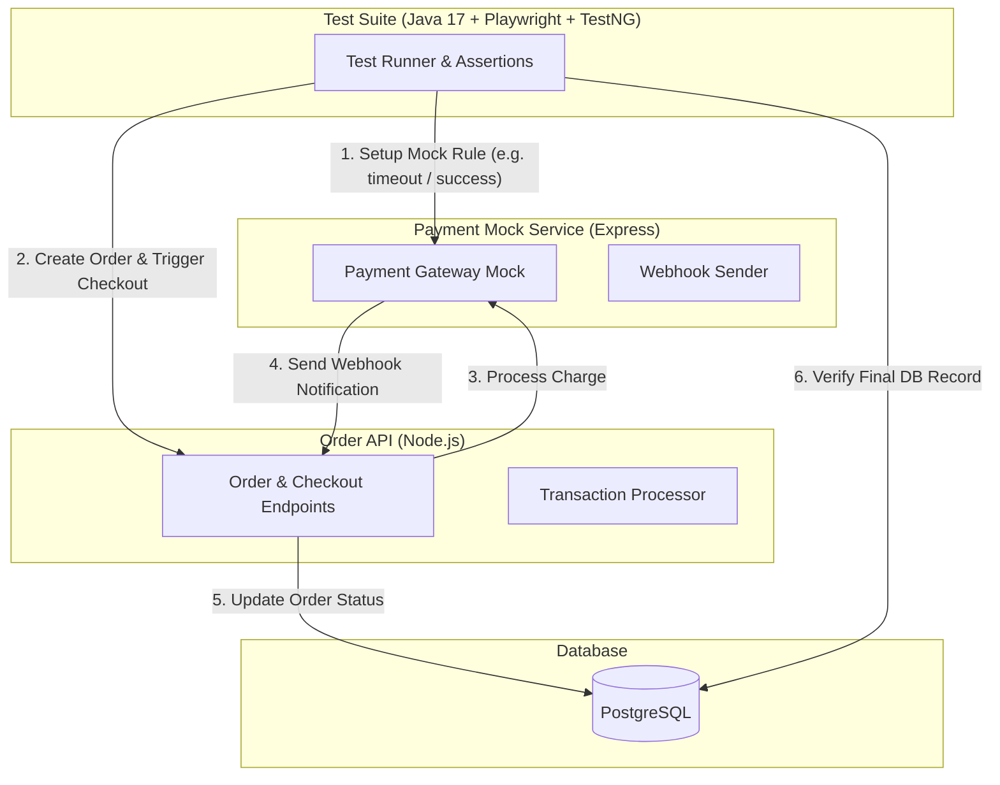

## Summary

In fintech systems, testing payment flows in staging is often difficult. Third-party payment gateway sandboxes frequently experience downtime, have strict rate limits, and make it hard to test error scenarios like failed payments, timeouts, or duplicate webhook notifications.

This project solves that problem by building a **self-contained test environment**:
1. **System Under Test (SUT)**: A realistic Node.js/Express Order API.
2. **Payment Mock Server**: A lightweight Express mock service that simulates payment outcomes on demand.
3. **Java Automation Suite**: A Java 17 + Playwright + TestNG framework that runs tests in parallel and checks both API responses and database tables.

---

## Why Mocking Payment Sandboxes Matters

When you rely directly on external vendor sandboxes during staging tests, you run into three big problems:
* **Unstable Sandboxes**: Vendor sandboxes experience maintenance windows or latency spikes, causing tests to fail intermittently.
* **Hard-to-Test Edge Cases**: It's difficult to force a real sandbox to return specific error codes (e.g. *insufficient balance*, *expired card*, or *webhook signature mismatch*).
* **Slow Regression Runs**: Sequential API calls to external vendors slow down your entire CI/CD pipeline.

---

## System Architecture

Instead of talking to external payment providers, the test runner tells our local mock service what outcome it expects, triggers the order flow, and verifies the final state in the database.



---

## How It Works

### 1. Programmable Mock Service (Express.js)
Before running a test, the Java test runner can configure the mock server via a simple HTTP call:
- Simulate network delay.
- Return custom status codes (`SUCCESS`, `DECLINED_INSUFFICIENT_FUNDS`, `TIMEOUT`).
- Send signed webhook callbacks back to the Order API.

### 2. Parallel Java Test Runner (Java 17 + Playwright + TestNG)
The test suite is written in Java 17 using TestNG for parallel execution:
- **Thread Safety**: Uses `ThreadLocal` instances for browser and API contexts so test workers don't clash.
- **Smart Waiting**: Uses condition-based polling instead of `Thread.sleep` to make tests fast and deterministic.
- **Dual Layer Checks**: Verifies the HTTP response status code AND queries PostgreSQL directly using JDBC to confirm that order balances and transaction statuses match.

```java
@Test(description = "Verify successful order payment flow with webhook callback")
public void testSuccessfulOrderPayment() {
    // 1. Tell mock to return SUCCESS for this order
    mockClient.setPaymentOutcome(orderId, PaymentOutcome.SUCCESS);

    // 2. Submit checkout request
    APIResponse response = orderClient.submitCheckout(orderId, paymentPayload);
    assertThat(response.status()).isEqualTo(200);

    // 3. Wait for async webhook processing and assert DB state
    await().atMost(5, SECONDS).untilAsserted(() -> {
        OrderRecord order = orderRepository.findById(orderId);
        assertThat(order.getStatus()).isEqualTo("PAID");
        assertThat(order.getPaidAmount()).isEqualTo(BigDecimal.valueOf(150000));
    });
}
```

### 3. Clear Test Reports with Allure 3
When a test fails in the CI/CD pipeline, Allure captures:
- Exact request and response payloads.
- Mock server configuration for that specific test run.
- Database query snapshots and full error stack traces.

---

## Key Results
* **Full Isolation**: Decoupled regression testing from third-party vendor downtime.
* **Fast Parallel Runs**: Parallel test execution provides faster feedback in CI/CD.
* **Stable Test Execution**: Predictable mock responses and condition-based waiting eliminated flaky test failures.
