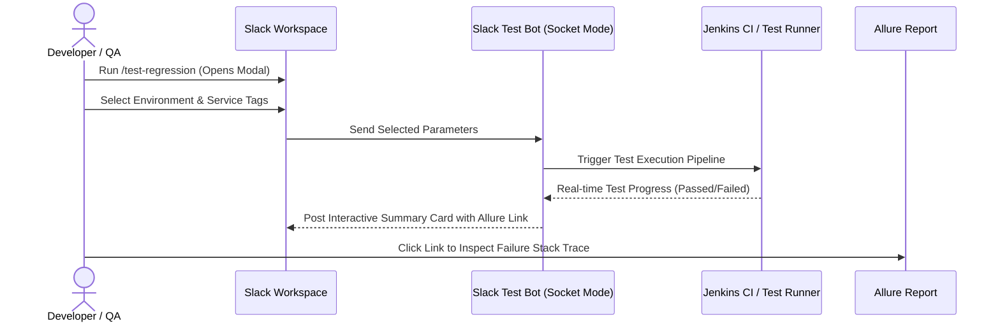

## Summary

In fast-paced engineering teams, triggering automated regression tests and checking results can take extra effort. Engineers often had to log into Jenkins dashboards, configure build parameters manually, and wait for full pipeline runs just to test a single service.

To solve this, I built an **internal Slack automation tool** and **custom Java JAR libraries**:
1. **Slack Test Bot**: Connects securely to Slack via Socket Mode, allowing engineers to trigger test suites via simple Slack slash commands or modal dropdowns.
2. **Instant Test Alerts**: Posts test run status, failure logs, and direct links to Allure reports into squad channels in real time.
3. **Shared Java Libraries**: Centralized common test utilities, database helpers, and reporting listeners into reusable JARs used across teams.

---

## The Problem

Before this tool was introduced, the workflow had noticeable friction:
* **Manual Jenkins Configuration**: Developers and QA analysts had to navigate multiple Jenkins jobs and enter parameter strings manually.
* **Delayed Feedback**: Engineers only discovered broken tests long after committing code, slowing down release deployments.
* **Code Duplication**: Different QA teams were writing their own helper scripts to trigger tests, causing duplicate maintenance effort.

---

## How the System Works

---

## Key Benefits
* **Simplified Trigger Flow**: Anyone can run regression tests directly from Slack without opening Jenkins.
* **Real-Time Failure Notifications**: When a test fails, developers get the error message and Allure report link immediately in their squad channel.
* **Shared Codebase**: Centralized Java JAR packages standardizes test utilities and listeners across teams.
